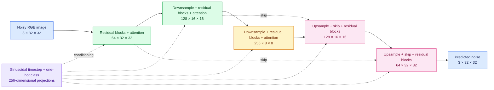

# Class-Conditional DDPM from Scratch in PyTorch

A custom denoising diffusion probabilistic model (DDPM) built from scratch in PyTorch for **32×32 CIFAR-10 generation**. Its **6,767,683-parameter U-Net** combines residual blocks, self-attention at multiple resolutions, sinusoidal timestep conditioning, 11-dimensional one-hot class conditioning (10 classes plus a null class), exponential moving average (EMA) weights, and classifier-free guidance (CFG). The [documented notebook](ddpm-documented-v66.ipynb) contains the complete experiment, code, saved outputs, and training evidence.

## Results

| Run | Run-local optimizer steps | Best 500-step average noise-prediction loss | Best run-local step | Logged run time |
| --- | ---: | ---: | ---: | ---: |
| v65 | 15,000 | 0.03161 | 14,000 | 6,169 s |
| v66 | 15,000 | 0.03054 | 14,500 | 6,055 s |

v66 resumed from **v65's best checkpoint at cumulative step 14,000**. The two runs executed **30,000 optimizer steps in total**; the v66 best and latest checkpoints record **28,500** and **29,000 cumulative steps** along the resumed checkpoint lineage. Those saved counters are retained as recorded. v66 processed 3,826,624 images in 6,055 seconds, giving approximately **632 images/sec run-local throughput**. The notebook's printed images/sec value uses a cumulative image counter with v66-only elapsed time and is not a run-local performance measure.

The notebook shows the original loss plots, class-conditioned samples, CFG comparisons, and six mixed-conditioning pairs. These are qualitative CIFAR-10 generations; no FID, Inception Score, or systematic human rating was measured.

## Architecture



The model predicts Gaussian noise over a 1,000-step linear beta schedule. Sampling uses the EMA model and combines conditional and null-class predictions through CFG.

## Repository contents

| File | Purpose |
| --- | --- |
| `README.md` | Quick start and verified project overview |
| [`ddpm-documented-v66.ipynb`](ddpm-documented-v66.ipynb) | Complete documented v66 experiment and captured outputs |
| `requirements.txt` | Notebook and public inference dependencies |
| `LICENSE` | MIT license for this project |
| `.gitignore` | Keeps local data, checkpoints, generated files, and environments out of Git |

The trained EMA weights are prepared separately for the [Hugging Face model repository](<HUGGING_FACE_MODEL_URL>); no weight or inference-helper file is part of this five-file GitHub repository.

## Quick start

Use Python 3.12 for the notebook environment:

```bash
python3.12 -m venv .venv
source .venv/bin/activate
python -m pip install --upgrade pip
python -m pip install -r requirements.txt
python -m jupyterlab ddpm-documented-v66.ipynb
```

The notebook is a preserved experiment artifact. Its initial checkpoint-copy cell uses a Kaggle-specific path; reproducing the full training run elsewhere requires the original starting checkpoint and corresponding path setup. The standalone path for generating an image from released weights is below.

## Inference from the Hugging Face package

The model uses a **custom PyTorch implementation**, not a Transformers or Diffusers pipeline. The only inference helper is shipped with the separate Hugging Face package. After replacing `<HUGGING_FACE_MODEL_URL>` with the published model URL, run this in the installed environment:

```python
import sys
from huggingface_hub import snapshot_download
import matplotlib.pyplot as plt

model_url = "https://huggingface.co/onebelowall/ddpm-cifar10-v66"
repo_id = model_url.removeprefix("https://huggingface.co/").rstrip("/")
package_dir = snapshot_download(
    repo_id=repo_id,
    allow_patterns=["config.json", "model.safetensors", "modeling_ddpm.py"],
)
sys.path.insert(0, package_dir)
from modeling_ddpm import load_pipeline

pipeline = load_pipeline(package_dir)
image = pipeline.sample("cat", seed=42, guidance_scale=3.0)
rgb = image.permute(1, 2, 0).numpy()
plt.imshow(rgb)
plt.axis("off")
plt.show()
plt.imsave("cat.png", rgb)
```

Choose any of `airplane`, `automobile`, `bird`, `cat`, `deer`, `dog`, `frog`, `horse`, `ship`, or `truck`. Sampling follows all 1,000 reverse steps and can be slow on CPU. A seed makes this public sampling path repeatable, but the package intentionally omits the notebook's saved reverse-process noise tensors, so it does not reproduce the notebook's images pixel for pixel.

## Reproducibility and limits

The notebook records fixed evaluation inputs, checkpoint metadata, loss logs, and the two-run checkpoint lineage. The public package exports the v66 best **EMA** weights. This compact 32×32 CIFAR-10 model is an educational and engineering demonstration, **not a state-of-the-art image generator**. No FID, Inception Score, or systematic human evaluation was performed.

Project code and released model weights are offered under the [MIT license](LICENSE). CIFAR-10 is a third-party dataset with its own [source and citation information](https://cave.cs.toronto.edu/kriz/cifar.html); this project's MIT license does not cover the dataset.
